

I build machine learning systems, game mods and desktop tools. Each project has a write-up at [maymeridian.dev](https://maymeridian.dev/) that gives its method, its measurements and its limitations. The source of [Echo](https://github.com/maymeridian/Echo) and of the [tidal disruption classifier](https://github.com/maymeridian/Tidal-Disruption-Classification) is public; the other projects are private.

### For science

Machine learning and measurement, checked against real data.

  <a href="https://maymeridian.dev/projects/tde/">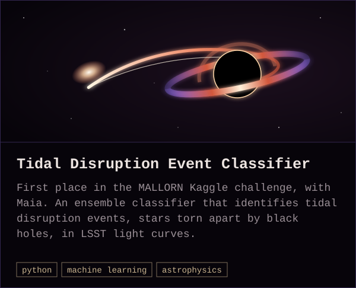</a>
  <a href="https://maymeridian.dev/projects/echo/">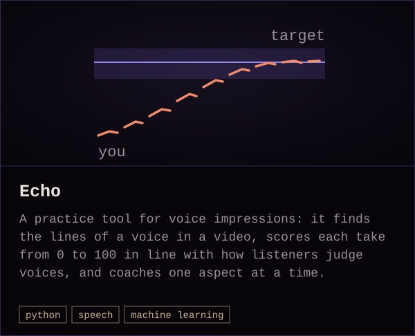</a>

### For fun

Games, mods and apps that anyone can use.

  <a href="https://maymeridian.dev/projects/solare/">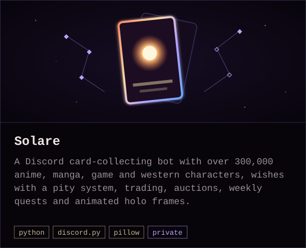</a>
  <a href="https://maymeridian.dev/projects/gojo-doorman/">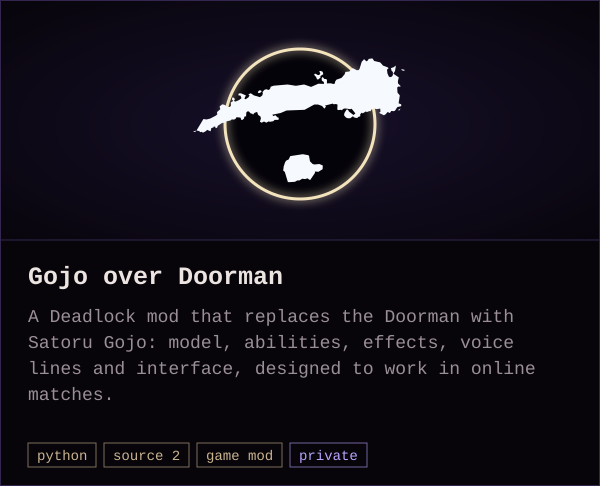</a>
  <a href="https://maymeridian.dev/projects/jedi-challenges/">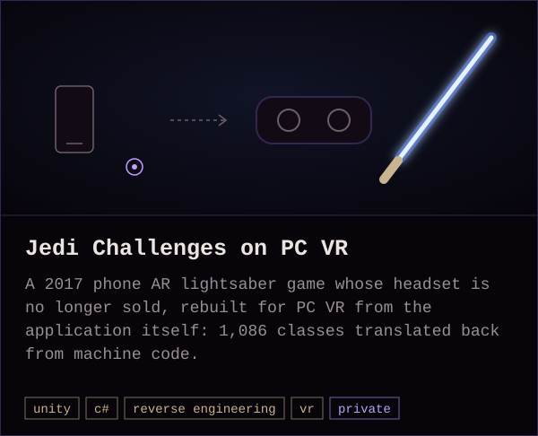</a>
  <a href="https://maymeridian.dev/projects/language-snap/">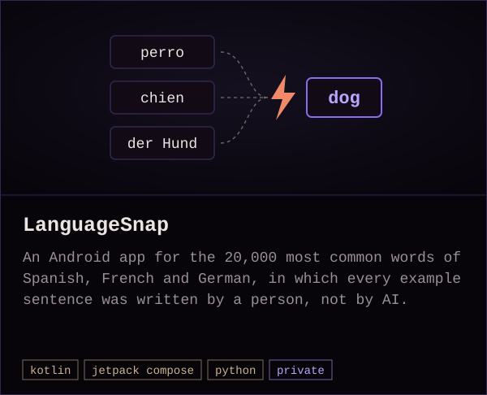</a>

### For Propabilia

In-house tools for Propabilia, a film and TV prop store, from finding stock to selling it.

  <a href="https://maymeridian.dev/projects/apollo/">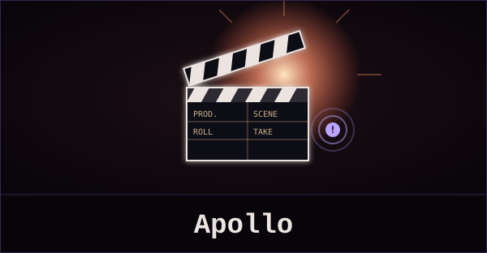</a>
  <a href="https://maymeridian.dev/projects/hephaestus/">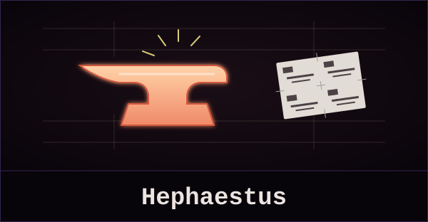</a>
  <a href="https://maymeridian.dev/projects/argus/">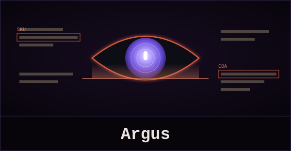</a>
  <a href="https://maymeridian.dev/projects/iris/">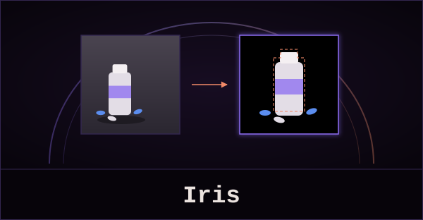</a>
  <a href="https://maymeridian.dev/projects/zeus/">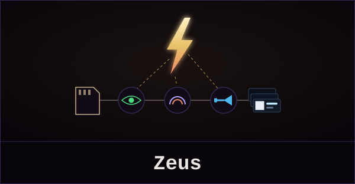</a>
  <a href="https://maymeridian.dev/projects/pheme/">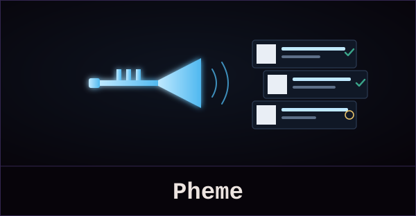</a>
  <a href="https://maymeridian.dev/projects/hermes/">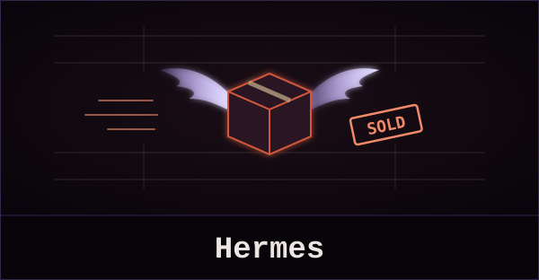</a>

el psy kongroo

